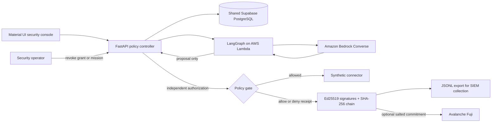

# AgentSafe: a safety checkpoint for AI agents

## Explain it to a five-year-old

Imagine a robot helper that can use school tools. Before it uses a tool, it shows a permission card to a safety teacher. The card says what the robot may do, what it may not do, and when its permission ends. The teacher checks the card, stops unsafe actions, and writes down what happened so people can check later.

That is AgentSafe: an AI may suggest an action, but the safety controller checks whether the action is allowed.

## The company problem

Businesses are connecting AI agents to email, databases, purchasing systems, and other tools. An agent can have legitimate access and still send a confidential record to the wrong place, exceed a mission budget, give a child agent too much authority, replay an old request, or keep acting after its mission has been revoked.

AgentSafe gives the company one control point for the actions it protects. It answers: which agent requested the action, which mission granted its authority, what rule allowed or denied it, and what evidence was recorded?

## A one-minute example

Acme Commerce asks its agents to review a fictional supplier invoice. Three specialists research the policy, assess the destination risk, and propose an action. The proposal asks to send the confidential invoice to a personal email address. AgentSafe checks the agent's signed, delegated mandate, identifies that the destination is forbidden, records a denial, and does not call a business connector. The operator can inspect the evidence and revoke the mission to stop future requests.

The people, invoice, company systems, and business effects in this demo are synthetic. Bedrock model calls, the controller, database, signatures, delegation proof, and AWS-hosted dashboard are real. No purchase, email, or external company tool is executed.

## How it works

```mermaid
sequenceDiagram
  participant Ops as Company operator
  participant Graph as LangGraph specialists
  participant Bedrock as Amazon Bedrock
  participant Gate as AgentSafe controller
  participant DB as Supabase PostgreSQL
  participant Tool as Synthetic demo connector
  Ops->>Graph: Start a company scenario
  Graph->>Bedrock: Research, assess risk, propose an action
  Bedrock-->>Graph: Model analysis and proposal
  Graph->>Gate: Submit the proposal as untrusted input
  Gate->>Gate: Verify signed mandate, scope, budget, expiry, revocation, destination, approval
  Gate->>DB: Save the policy decision before any connector call
  alt Policy allows and durable save succeeds
    Gate->>Tool: Pass the exact checked parameters
    Tool-->>Gate: Synthetic result
    Gate->>DB: Save signed result receipt
  else Policy denies or save fails
    Gate-->>Graph: Stop; no connector is called
  end
  Ops->>Gate: Inspect evidence or revoke future authority
```



## What is real in the prototype

| Capability | Implementation | What it demonstrates |
| --- | --- | --- |
| Agent workflow | Three-step LangGraph graph, hosted on AWS Lambda | A real orchestration framework coordinates specialists; the controller alone authorizes their proposals |
| Model inference | Amazon Bedrock Converse | Five-model fallback chain: Claude Sonnet 4.5, Mistral Pixtral Large, Nova Lite, Claude Haiku 4.5, Nova 2 Lite |
| Authorization | FastAPI controller and signed mission grants | Tool, resource, parameters, delegation, budget, expiry, revocation, and approval checks |
| Shared state | Supabase PostgreSQL session pooler | Missions and audit evidence persist across browser sessions and deployments |
| Signatures | Ed25519 | Verify which controller key signed a mandate or receipt |
| Audit history | SHA-256-linked, signed events | Detect edits to retained journal history and export JSONL |
| Delegation privacy | Circom, Poseidon, Groth16, snarkjs | Prove selected parent/child mandate limits at delegation time |
| On-chain checkpoint | Deployed Avalanche Fuji `AuditAnchor` contract | A salted journal commitment is confirmed on Fuji; later checkpoints require explicit wallet confirmation |
| Analyst console | React, TypeScript, Material UI, Vite | Inspect missions, decisions, alerts, evidence, and revocation controls |

## Model routing

Each specialist tries the configured chain in order. A provider error, empty response, or unusable planner result moves to the next option. If all five fail, the workflow stops without authorizing a proposal.

1. Anthropic Claude Sonnet 4.5
2. Mistral Pixtral Large
3. Amazon Nova Lite
4. Anthropic Claude Haiku 4.5
5. Amazon Nova 2 Lite

The model chain generates suggestions. AgentSafe's controller makes the separate allow or deny decision.

## What the cryptography proves

- **Ed25519 signatures** authenticate signed mandates, requests, and receipts against a public key.
- **SHA-256 chaining** makes changes to retained events detectable. An unanchored newest tail can still be deleted by a database administrator.
- **Groth16 delegation proof** demonstrates only the parent/child constraints encoded in the circuit. The demo uses development proving parameters, not an audited production ceremony.
- **Avalanche Fuji checkpoint** records a salted commitment for a verified journal head. It does not publish the journal or prove that its contents are true. The contract is real; the wallet must approve a zero-value testnet transaction and pays test-network gas.

The demo has a confirmed Fuji transaction: [verify the journal checkpoint](https://build.avax.network/explorer/fuji/c-chain/tx/0xd78024ab65943451fc6ebb37c962e1cf3b581876a6c3d68ab5b7907a5861aa4e). The workflow also completed from the live dashboard: three Bedrock specialists proposed an external personal-email transfer, AgentSafe blocked it, and the signed journal stayed valid.

## What the demo does not claim

- The live architecture uses AWS Lambda as its runtime, LangGraph for multi-agent orchestration, and Bedrock for model calls. LangGraph and AgentCore serve different layers: LangGraph coordinates the agents; AgentCore is an optional managed runtime/platform. The workshop role denies AgentCore runtime operations, so this deployment uses Lambda directly and does not depend on AgentCore.
- OpenSearch is not provisioned. The specialists receive short fictional policy notes bundled with the service; there is no vector search.
- Business connectors are synthetic. No real email, purchase, finance, supplier, or customer system is connected.
- The group roster is demonstrative. It does not issue cryptographic group credentials or establish shared budgets for real agents.
- JSONL is ready for a log collector, but a live Splunk, Sentinel, Datadog, or SOAR integration is not configured.
- The demo approval flow does not authenticate an actual employee.
- Signatures do not prove that the source data classification was correct or that a model's reasoning is true.
- This is a working hackathon prototype, not a production security gateway. Real enterprise connectors, identity integration, tenant isolation, key management, ZK setup, and independent review remain necessary.

## Short pitch

> AgentSafe puts a verifiable permission check between AI agents and the tools they can affect. Agents can research and propose, while the controller enforces mission limits, blocks prohibited transfers, records signed evidence, and gives security teams a way to stop future actions. The demo runs a real LangGraph and Bedrock workflow on AWS against a persistent synthetic company workspace, with Ed25519 audit receipts, Groth16 delegation proofs, and a confirmed Avalanche testnet checkpoint.
