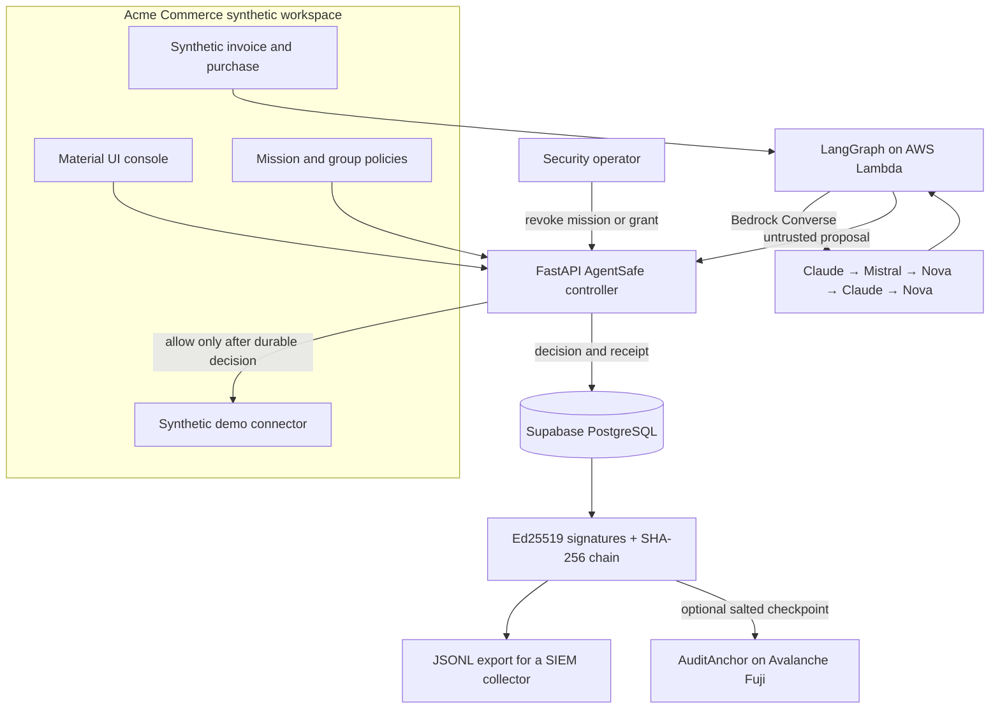

# AgentSafe, explained simply

## Explain it to a five-year-old

Imagine a robot helper is allowed to use a few school tools. Before it uses one, it shows a permission card to a safety teacher. The card says what the robot may do, what it may not do, and when the card expires.

The robot can ask to send a private paper to someone outside school. The safety teacher checks the card and says no. The teacher writes down what happened so people can check later. A grown-up can turn off the card so the robot cannot use it again.

That is AgentSafe: the AI suggests; AgentSafe checks and decides.

## A company example

The demo company is **Acme Commerce**, a made-up online shop. It has three named agents:

- `ag-policy-researcher` finds the rules that apply to the task.
- `ag-data-guardian` reviews where confidential information may go.
- `ag-procurement-planner` suggests the next action.

The agents review a pretend invoice. They can suggest sharing it, but the controller blocks a transfer to personal email. For a pretend purchase, a delegated agent has a smaller budget than its parent mission, and a person must approve the exact order before the synthetic connector records it.

Every company record in the demo is synthetic. The controller, signatures, proof verifier, database, AWS model calls, and Fuji contract are real components. No real email, order, or supplier system is connected.

## The workflow

```mermaid
sequenceDiagram
  participant U as Company workflow
  participant L as LangGraph specialists
  participant B as Amazon Bedrock
  participant C as AgentSafe controller
  participant P as Signed policy and mission
  participant D as Demo connector
  participant J as Audit journal
  U->>L: Ask for a proposal about a synthetic invoice
  L->>B: Research, risk review, and planning calls
  B-->>L: Model-written analysis and proposal
  L-->>C: Untrusted proposed destination
  C->>P: Check identity, signature, scope, budget, expiry, and approval
  C->>J: Save the allow or deny decision first
  alt Policy allows and the journal write succeeded
    C->>D: Execute only the checked synthetic action
    D-->>C: Synthetic result
    C->>J: Save result and signed receipt
  else Policy blocks or durable save failed
    C-->>L: Stop; do not call the connector
  end
```

1. An administrator creates a mission with tools, resources, budget, expiry, and delegation rules.
2. An agent receives a signed mandate. A child mandate must be narrower than the parent's mandate.
3. For a delegation, the prototype creates and verifies a Groth16 proof about the rules encoded in its circuit.
4. The model workflow produces a proposal. Model output is never treated as an authorization.
5. The controller checks the signed request, destination, permissions, revocation, replay protection, budget, and required approval.
6. The controller saves its decision before any protected connector is called. If saving fails, the action is blocked.
7. The controller signs a receipt for what it checked or observed. It does not claim that the AI's explanation is true.

## Two ways to run a scenario

**AWS live workflow:** AWS Lambda runs three sequential LangGraph specialists. Each specialist calls Amazon Bedrock using this five-model fallback order:

1. Anthropic Claude Sonnet 4.5
2. Mistral Pixtral Large
3. Amazon Nova Lite
4. Anthropic Claude Haiku 4.5
5. Amazon Nova 2 Lite

The first model that returns a usable response is used for that specialist. If every model fails, the workflow stops. The controller still independently evaluates any proposal. The hosted demo limits this shared AWS workflow to ten runs per UTC day.

The workshop role does not allow AgentCore runtime operations. OpenSearch is not provisioned, so this version gives the specialists the fictional company's short policy notes from the service itself. It does not claim to use an AgentCore runtime or OpenSearch.

**Deterministic policy workflow:** fixed synthetic requests exercise delegation, confidential data rules, budget limits, and approval requirements. It does not call a model or AWS. Both paths use the same controller and company database.

## System map



## What the cryptography does

- **Ed25519:** signs mandates, requests, and controller receipts. A signature can be checked against its public key.
- **SHA-256 event chain:** each event includes the prior event's hash. Changing an event in the middle breaks the later links. The newest events can still be deleted before an external checkpoint exists.
- **Groth16:** proves the limited parent/child permission relationship encoded in the demo circuit. This proof is created at delegation time, not for each message or model call. The current setup is for development, not production.
- **Avalanche Fuji:** can store a salted fingerprint of a verified journal head. The chain does not receive the journal or its salt. The user must confirm the zero-value testnet transaction in MetaMask, and the wallet pays test-network gas.

These parts do different jobs. A blockchain checkpoint does not decide whether an action is safe. The controller does that.

## What the screens mean

- **Overview:** which missions and recent decisions are in the demo company.
- **Run a workflow:** the live AWS model path or the local fixed policy scenario.
- **Agent permissions:** what each named agent may do, and when that authority expires.
- **Groups & missions:** mission budgets and the fictional team roster.
- **Audit evidence:** signed journal, verification, JSONL download, and optional Fuji checkpoint.
- **Alerts & response:** blocked requests and controls to stop future activity.

## Limits to say out loud

- The company, people, invoice, policy notes, and business effects are invented for the demo.
- The workflow does not send real messages or make real purchases.
- A proof covers only the properties written into its circuit.
- A signature cannot prove that a data label was correct at the source.
- Revoking a mission stops future requests; it cannot undo a completed action.
- JSONL can be collected by tools such as Fluent Bit, but a live SIEM integration is not configured.
- Group rosters are shown in the UI, but this prototype does not issue separate cryptographic credentials to each group member.
- The demo is not a production-ready security gateway until real company connectors, identities, key operations, ZK parameters, and independent security review are added.
