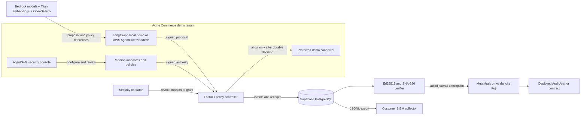

# AgentSafe: A simple explanation and technical guide

## Explain it to a five-year-old

Imagine a school has a robot helper. The robot can read a list, but it should not be able to send every page to anyone or buy anything it wants.

AgentSafe is the grown-up who checks the robot's permission slip before it does a protected thing. The slip says which tools it can use, what it can touch, how much it can spend, and when the permission ends. AgentSafe writes down whether it said yes or no. If the robot asks to send a private invoice to a stranger, AgentSafe says no and keeps the invoice inside the demo company.

The robot can suggest. AgentSafe decides. A person can stop the mission.

## The 30-second pitch

Companies are adding AI agents to procurement, support, finance, and internal operations. Existing agents can call tools with legitimate credentials, but companies need a reliable way to limit each mission, prevent unsafe data flows, trace delegated authority, and stop future actions.

AgentSafe is a control plane placed between agents and protected tools. It checks signed, mission-scoped permissions before an action runs, applies data and budget rules, requires exact-action approvals where needed, and records signed evidence for security operations. The demo makes these checks visible in a realistic company workspace instead of presenting a disconnected list of cryptographic components.

## What the product is

AgentSafe is the policy enforcement and evidence layer around existing AI workflows. It does not replace an agent framework or the company's tools. An agent proposes an action; AgentSafe validates it; a protected connector executes only an allowed request.

The application has a fictional tenant, **Acme Commerce**, representing a 500-person online retailer. Its agents, invoices, policies, and connector outcomes are synthetic but persisted in the same application database as the rest of the demo. The tenant shows how a company would configure missions, agent groups, tool permissions, approval steps, alerts, and audit evidence. No real company email, supplier, finance, or business-system connector is enabled in this prototype.

## The company scenario

Acme's finance team asks an agent to prepare a €70 purchase from approved supplier #42. The company allows procurement proposals up to €100 for the mission, but the delegated planner has an €80 limit. A human must approve the exact proposed order before the local demo connector records it.

At the same time, the agents may read invoice `invoice-1842`, which is labeled confidential. They may not send it to an external personal address. The demo includes both the safe path and blocked paths so that reviewers can see what happens and why.

| Scenario | Expected behavior |
| --- | --- |
| Send a confidential invoice outside the company | Block before the connector runs; record the reason |
| Propose an order within mandate | Pause for approval bound to the exact order parameters |
| Try to exceed the child or mission budget | Deny without executing the connector |
| Delegate to another agent | Check that the child mandate is narrower and verify its Groth16 proof |
| Revoke a mission | Block future actions under its grants and descendants |
| Check audit history | Verify Ed25519 signatures and the SHA-256 event chain |
| Anchor a journal checkpoint | Send a salted commitment to the deployed Avalanche Fuji contract and verify the receipt |

## Product screens

- **Overview:** company context, what is currently connected, and the latest security state.
- **Run a workflow:** run the deterministic local scenario or, when its AWS bridge is configured, the live AWS specialist workflow. Each is labeled by the systems it calls.
- **Agent permissions:** inspect each named agent's mandate, limits, status, and revoke control.
- **Groups & missions:** manage a mission's budget and a group principal. The displayed roster is descriptive; per-member derived credentials are not implemented yet.
- **Audit evidence:** inspect the signed journal, verify it, and download JSONL for a SIEM collector.
- **Alerts & response:** investigate denials and revoke a mandate tree. Revocation stops later requests; it cannot undo completed actions.

## How one protected action works

```mermaid
sequenceDiagram
  participant W as Agent workflow
  participant C as AgentSafe controller
  participant G as Signed mandate and policy store
  participant J as Supabase journal
  participant T as Protected connector
  W->>C: Signed proposal with request ID and exact parameters
  C->>G: Check signature, tool, resource, budget, expiry, revocation, replay, approval
  C->>J: Persist the allow or deny decision first
  alt Request is allowed and journal write succeeds
    C->>T: Execute the exact checked parameters
    T-->>C: Return result
    C->>J: Store result and signed receipt
    C-->>W: Return receipt
  else Denied or persistence failed
    C-->>W: Deny; do not call the connector
  end
```

1. The company creates a mission mandate. It identifies the agent, allowed tools and resources, parameter rules, budget, expiry, delegation rights, and required approvals.
2. An agent sends a proposal with a unique request ID and an Ed25519 signature. Model output is untrusted input, even when it came from a trusted model provider.
3. FastAPI checks the signature and mandate, then checks scope, data destination, expiry, revocation, replay, cumulative budget, and exact-request approval.
4. The decision is written to the journal before the connector runs. If durable persistence fails, the controller fails closed.
5. An allowed request reaches a registered connector. In this demo, connectors only write synthetic artifacts; they do not contact an external business system.
6. The controller records the observed result and signs a receipt. The receipt says what the controller checked or observed, not that the AI's reasoning or an external fact is true.

## Architecture and data flow



### What runs where

| Component | Technology | Job |
| --- | --- | --- |
| Security console | HTML, CSS, browser JavaScript | Show tenant state and invoke the API |
| Policy API | Python, FastAPI, Pydantic | Verify grants, evaluate policy, control connectors, sign receipts |
| Durable demo data | Supabase PostgreSQL session pooler | Persist missions, grants, approvals, alerts, artifacts, journal, and anchor records |
| Local isolated mode | SQLite | Run a developer-only instance without shared hosted state |
| Agent workflow | LangGraph local demo; Strands agents on AWS AgentCore when deployed | Produce proposals, never authorize them |
| Model providers | Amazon Bedrock; Anthropic models first, Mistral as last fallback | Draft role-specific analysis and proposals in the AWS workflow |
| Policy retrieval | Amazon Titan embeddings and OpenSearch Serverless | Retrieve synthetic policy notes for the AWS agents |
| Mandate and receipt signatures | Ed25519 | Authenticate signed permissions and controller receipts |
| Journal integrity | SHA-256 hash chain | Link events so edits or missing middle events are detectable |
| Delegation privacy | Circom, Poseidon, Groth16 on BN254 | Prove the encoded child mandate is within its parent mandate |
| External checkpoint | Avalanche Fuji C-Chain contract and MetaMask | Store a salted commitment to a verified journal head |
| Hosting | Vercel | Host the API, console, and isolated AWS identity bridge |

## Why there are several cryptographic parts

These parts do different jobs; the blockchain does not replace them.

- **Ed25519 signatures:** prove that a mandate, action request, or receipt was signed by the expected key. The controller rejects invalid signatures.
- **SHA-256 journal chain:** each event includes the previous event's hash. Changing an earlier event breaks later links. An administrator can still remove the newest unanchored tail.
- **Groth16 delegation proof:** proves that a child mandate satisfies the constraints encoded by this prototype's circuit, without making the full parent mandate public to the proof verifier. It is generated when the child grant is created, not for every model message or tool call.
- **Avalanche Fuji checkpoint:** after verifying the journal locally, the console derives a salted commitment to the current journal head and asks MetaMask to call the deployed `AuditAnchor` contract. The chain receives the commitment, not the event bodies or salt. The API records an anchor only after it verifies the successful Fuji receipt and matching contract event.

The contract is deployed at `0xde5648cded04c9eca1124234867780604f89ff7e` on chain ID `43113`. This is a real transaction on a public test network. MetaMask pays Fuji test AVAX for gas; the contract call transfers **0 AVAX as transaction value**. The checkpoint is an external witness for that journal head, not a real-world audit certification and not the policy authorization mechanism.

The Groth16 circuit's current parameters are for a development demo, not an audited production ceremony. A proof verifies only the properties actually encoded in the circuit. Cryptography cannot fix incorrect source labels, bypassed connectors, compromised keys, or a dishonest external tool.

## The AWS workflow and model fallback

The intended AWS path uses the workshop's requested services:

1. Amazon Bedrock AgentCore Runtime runs three specialists: Research, Security Analyst, and Action Planner.
2. Amazon Bedrock runs the model calls. Each specialist uses a task-specific Anthropic model first and tries the configured fallbacks; Mistral is last.
3. Amazon Titan creates embeddings for synthetic policy notes.
4. Amazon OpenSearch Serverless retrieves the relevant notes.
5. AgentCore returns an untrusted proposed action to the separate AgentSafe FastAPI controller.
6. AgentSafe checks and records the decision. The runtime has no business-tool credentials and does not execute the proposed business action.

The local deterministic workflow is separately labeled. It does not call any model or AWS service, but it exercises the real controller, database persistence, policy checks, Groth16 delegation proof code, and synthetic connectors. The AWS button must report unavailable until the runtime, OpenSearch index, model permissions, and Vercel OIDC bridge are all configured and a full request succeeds. Checking model access by itself is not proof that this end-to-end path works.

## What is real in this demo and what is not

**Working product paths:** the browser console reads persisted API state; the controller issues and checks signed mandates; the deterministic LangGraph scenario exercises policy decisions and local demo connectors; the Groth16 delegation proof is generated and verified; Supabase Postgres persists hosted state; the journal verifier checks signatures and hashes; JSONL is exportable; the deployed Fuji contract can store and verify salted checkpoints after a wallet transaction is confirmed.

**Requires customer integration or AWS setup:** real procurement, email, finance, identity-provider, and SIEM integrations; production AgentCore and OpenSearch resources; authenticated approver identities; individual group-member credentials; key rotation and recovery; audited ZK setup; retention and backup controls; and operational monitoring.

The company workspace is a realistic simulation, not a connection into Acme Commerce or a customer's private network. A customer deployment would install or connect the controller to approved company systems, register each protected connector, map the customer's identities and policies, and ensure agents cannot call protected tools around the controller.

## Short demo script

1. Open **Acme Commerce** and explain that all business records are synthetic, while the controller/database/cryptography paths are real.
2. Run the local policy checks. Point out the allowed internal transfer, blocked external confidential transfer, missing-approval denial, and exact order waiting for human approval.
3. Open the agent permissions and show the named `ag-` principals, parent and child mandates, shared mission limit, expiry, and revocation state.
4. Open the journal verifier. Show the persisted events, signatures, hash chain, and JSONL export.
5. Use the Fuji checkpoint button only after verifying the journal. MetaMask displays the target chain, contract, and zero AVAX transaction value; after confirmation, show the transaction and on-chain commitment verification.
6. Show the AWS workflow status honestly. If the AWS bridge is ready, run the specialist flow and trace its retrieved notes, proposal, and independent controller decision. Otherwise show the explicit not-configured state and use the deterministic local path.

## Questions the jury may ask

**Does the LLM decide whether an action is allowed?** No. It proposes. The signed mandate and deterministic controller policy decide.

**Can an agent bypass AgentSafe?** Only if the company leaves direct credentials or alternate network routes available. The integration must remove direct tool credentials from agents and place the protected tool behind the controller.

**Does a blockchain transaction prove the AI was correct?** No. It anchors a salted fingerprint of the verified journal head. It helps detect later changes to that checkpointed history.

**Why use zero-knowledge proofs?** The delegation demo proves selected parent-child mandate constraints without disclosing the whole parent mandate to the verifier. This demo does not use a ZK proof for every action.

**Does a denial undo an action?** No. AgentSafe stops the protected action before the connector runs. Revocation blocks future calls; it cannot undo completed work.

**Is this production-ready?** It is a functioning hackathon prototype with real hosted persistence and a real testnet checkpoint path. It is not a production security gateway until the customer integrations, identity controls, key management, ZK setup, availability, and independent security review are completed.
