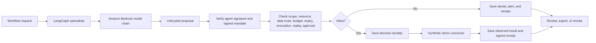
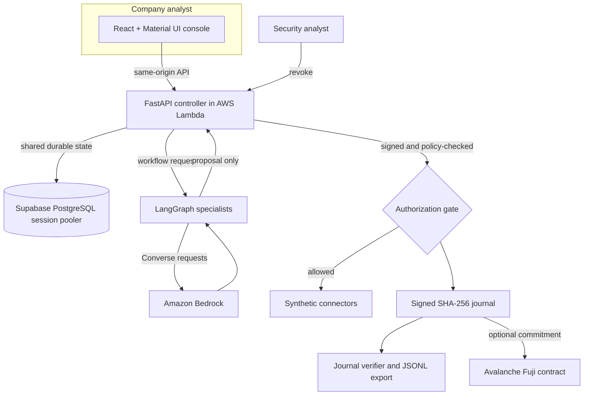

# AgentSafe project guide

## Purpose

AgentSafe is a control and audit layer that sits between an AI workflow and selected tools. It checks signed, mission-scoped permissions before a protected action can run. A denied action does not reach its connector. A permitted action is recorded before the controller passes the exact checked parameters to the demo connector.

The shared workspace represents **Acme Commerce**, a fictional online retailer. Its agent names, supplier, invoice, policies, and tool results are synthetic. The controller and shared PostgreSQL database are real services. The demo has no connection to an actual company's internal ecosystem.

## How a request moves

1. A mission defines a root agent's scope, resource set, budget, expiry, and delegation permission.
2. A parent can delegate narrower authority. AgentSafe checks the child rules and verifies the Groth16 proof generated for the selected parent/child properties.
3. The workflow sends a unique, signed action request. The controller rejects a bad signature, replay, expired or revoked grant, out-of-scope tool, unsafe destination, excess budget, or missing approval.
4. The controller commits the decision before calling a protected connector. A database failure means no connector call.
5. The connector in this demo only writes synthetic artifacts. The controller signs the observed outcome and links its audit event to prior events.
6. An analyst can revoke a mission or grant to stop future requests. This does not reverse work already completed.

## AWS model path

The workshop account explicitly denies AgentCore runtime API access. The deployed AWS plan therefore uses Lambda as the application runtime, LangGraph for the three-specialist workflow, and direct Bedrock Converse calls. The order is Anthropic Claude Sonnet 4.5, Mistral Pixtral Large, Nova Lite, Anthropic Claude Haiku 4.5, then Nova 2 Lite. Each step tries that chain and fails closed if no model returns a usable answer.

OpenSearch Serverless has not been provisioned in the workshop account. The AWS specialist workflow receives a short set of synthetic policy notes bundled with the service. It does not claim vector search or AgentCore. The public live demo is capped at ten model workflows each UTC day.

## Architecture

## Main components

| Component | Current implementation |
| --- | --- |
| Dashboard | React, TypeScript, Material UI, Vite |
| Controller | Python, FastAPI, Pydantic |
| Shared state | Supabase PostgreSQL through the session pooler |
| Isolated development | SQLite |
| Agent orchestration | LangGraph running in the AWS-hosted controller container |
| Model inference | Amazon Bedrock Converse, with a five-model fallback sequence |
| AgentCore | Not available under this workshop role; not used by the deployed path |
| OpenSearch | Not provisioned; policy notes are bundled synthetic examples |
| Signatures and journal | Ed25519 mandates/receipts and a SHA-256-linked event log |
| Delegation privacy | Circom 2, Poseidon, Groth16, snarkjs |
| Optional public checkpoint | Avalanche Fuji `AuditAnchor` contract |

## Credentials and data

The AWS function reads the PostgreSQL connection string and the existing signing key from one AWS Secrets Manager secret. Its execution role can read that secret and invoke only the listed Bedrock model profiles. The browser never receives those values. Lambda uses its own AWS role; there is no Vercel-to-AWS identity bridge.

The journal stores IDs, decisions, hashes, and keyed commitments rather than raw prompt or document contents. The demo's policy data itself is synthetic. The controller needs a stable signing key because changing that key would invalidate signatures already stored in the shared journal.

## What the evidence proves

- An Ed25519 signature verifies which key signed a mandate or receipt.
- A SHA-256 chain detects changes and removed events in the checked section of the journal.
- A Groth16 proof establishes the selected scope relationship that the circuit encodes.
- A Fuji transaction can show that a salted fingerprint was recorded on that test network.

None of these prove that an AI explanation was correct, that an initial data label was correct, or that a third-party tool's response was true. The newest journal events remain vulnerable to deletion until an external checkpoint records them.

## Demo limits

- No external procurement, email, finance, identity, or SIEM connector is enabled.
- Human approval is a synthetic demo flow, not enterprise identity authentication.
- Group member lists do not create member-specific keys.
- The Groth16 setup is a development artifact, not a production ceremony.
- JSONL output can be ingested by a collector, but no SIEM service is connected.
- The shared live AWS workflow is intentionally rate-limited to ten runs per day.

See [`HOW_AGENTSAFE_WORKS.md`](HOW_AGENTSAFE_WORKS.md) for the five-year-old explanation and presenter script. See [`PRODUCT_SPEC.md`](PRODUCT_SPEC.md) for scope and requirements.
