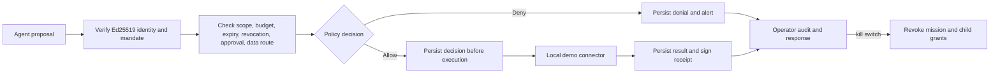
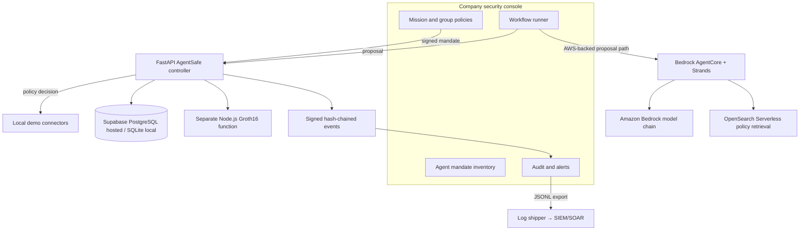

# AgentSafe: Project Guide

## What the product does

An AI agent can have legitimate access and still use it dangerously: send confidential information to the wrong destination, exceed a mission budget, delegate excessive authority, replay a request, or act after cancellation. AgentSafe places a controller between agents and selected tools. The agent proposes; the controller evaluates the signed mandate and policy; only an allowed, durably recorded action can reach a protected connector.

The hosted demo represents Acme Commerce, a fictional company. Agents, invoices, rules, and connector effects are synthetic and persisted through the application. No real company tool is connected.

## See the system work

Use the live console at <https://agentsafe-nu.vercel.app>. The overview explains the product, then the workflow page separates AWS model calls from deterministic local policy checks. Agent permissions, groups and missions, audit evidence, and alerts are separate pages so an operator can find the relevant function quickly.

The AWS AgentCore runtime and OpenSearch Serverless collection are provisioned in the workshop account. The Vercel production function still lacks an AWS identity bridge: AWS Organizations denied creation of the Vercel OIDC identity provider. Therefore, the hosted AWS button remains unavailable until the workshop administrator permits that trust setup or provides an approved bridge. A successful workflow request and its persisted controller decision are the proof of end-to-end readiness. Local policy checks are deterministic, do not call an LLM, and label their artifacts as synthetic.

## Request path



1. Create a mission with a root public key and bounded authority.
2. The parent agent signs a delegation claim. AgentSafe verifies the parent signature and checks the child does not widen scope, budget, duration, or delegation rights.
3. A Groth16 proof demonstrates the encoded parent-child relation, then a separate verifier checks it before the child grant is issued.
4. Each action request includes a unique request ID and an Ed25519 signature. The controller verifies the request, durably stores its decision, and invokes a connector only after an allow.
5. The response is stored separately. If the result is ambiguous, the journal records an unknown result instead of silently refunding budget.

## Product map



## AWS model chain

The deployed runtime is configured with four Bedrock IDs: `eu.anthropic.claude-sonnet-5-5`, `eu.anthropic.claude-haiku-5-5`, `global.anthropic.claude-sonnet-5-5`, and `eu.mistral.pixtral-large-2502-v1:0`. Each specialist tries its role preference first, then the rest of this chain. Anthropic precedes Mistral. Provider errors, empty output, and invalid planner JSON trigger fallback. If the chain is exhausted, the runtime fails closed. The Anthropic first-use form has been submitted; model invocation still needs to succeed in the live runtime before this chain can be called verified.

## Local development

From the repository root:

```bash
cd controller
uv sync
npm ci
npm run build
uv run uvicorn app:app --host 127.0.0.1 --port 8765
```

The Groth16 artifacts are a one-party development setup. Their presence proves that the code can generate and verify the demo proof, not that the parameters are production-audited.

## What the evidence means

Journal events contain identifiers, policy decisions, keyed commitments for private resource and destination values, and links to preceding events. They do not contain raw request payloads. SHA-256 links and Ed25519 signatures make edits detectable in an exported journal. A database administrator can still delete an uncheckpointed tail. A valid signature shows that the controller signed the event; it does not establish that a model answer or external system result is true.

## Boundaries

- Demo connectors write synthetic artifacts only; they do not send mail or place real orders.
- The approval interaction is a demo issuer, not authenticated enterprise identity management.
- Group names and rosters do not issue member-specific credentials.
- Labels are declared by signed callers; trusted source labeling and propagation are not implemented.
- JSONL is ready for a log shipper but no live Splunk, Sentinel, or Datadog integration is configured.
- The journal checkpoint can be anchored on Avalanche Fuji; a checkpoint is marked confirmed only after the Fuji transaction receipt and contract event are checked.
- The current ZK setup is not a production trusted ceremony.

See [`HOW_AGENTSAFE_WORKS.md`](HOW_AGENTSAFE_WORKS.md) for the plain-language walkthrough and Mermaid sequence. See [`PRODUCT_SPEC.md`](PRODUCT_SPEC.md) for requirements and limits.
