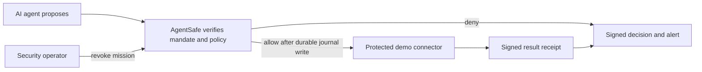

# AgentSafe

AgentSafe is a security control layer for AI agents. The agent proposes an action; AgentSafe checks its signed mission authority, tool scope, data route, budget, expiry, revocation, and required approval before a protected connector can run. The controller records the decision and returns a signed receipt.

## Open the demo

Live console: <https://agentsafe-nu.vercel.app>

The demo company is **Acme Commerce**, a fictional workspace. Its agents, invoices, policy notes, and connector results are synthetic. App records are read from the API/database rather than invented as a hard-coded activity feed. Connectors create local demo artifacts only; they do not send mail, place purchases, or call real company systems.

The dashboard has separate views for the workflow, agent permissions, group missions, audit evidence, and alerts/response. Start with **Run a workflow**. The AWS workflow makes real Bedrock and OpenSearch calls only when its AgentCore runtime and Vercel-to-AWS identity are configured. The deterministic local policy suite does not call an LLM. Each option states which systems it uses. Check the status page and successful workflow record before describing the AWS path as live.

## How it works



The AWS-backed workflow uses three sequential Strands agents hosted by Bedrock AgentCore: Research, Security Analyst, and Action Planner. Role-specific Anthropic models are tried first, followed by a four-model fallback chain ending with Mistral Devstral. The model output remains an untrusted proposal; only the AgentSafe controller decides. See [`HOW_AGENTSAFE_WORKS.md`](HOW_AGENTSAFE_WORKS.md) for detailed sequence and model-routing diagrams.

## Stack

| Area | Technology |
| --- | --- |
| Controller/API | Python, FastAPI, Pydantic |
| Persistence | Supabase PostgreSQL via transaction pooler; SQLite for isolated development |
| Agent orchestration | Amazon Bedrock AgentCore Runtime, Strands Agents |
| Model routing | Amazon Bedrock: Claude Sonnet 4.5 → Claude Haiku 4.5 → Claude Sonnet 4.6 → Mistral Devstral 2 123B |
| Policy retrieval | Titan embeddings and OpenSearch Serverless |
| Delegation proof | Circom 2, Poseidon, Groth16, snarkjs |
| Signatures and journal | Ed25519, SHA-256 hash chain |
| Hosting | Vercel FastAPI with separate Node proof and AWS bridge functions |

## Local run

Requirements: Python 3.10+, Node.js 20+, npm, and [`uv`](https://docs.astral.sh/uv/).

```bash
cd controller
uv sync
npm ci
npm run build
uv run uvicorn app:app --host 127.0.0.1 --port 8765
```

Open <http://127.0.0.1:8765>. For development policy setup, `npm run build` prepares the local Groth16 artifacts. This one-party setup is not a production trusted ceremony. The controller fails closed if proof generation or verification fails.

## Verification

Run the checks from the `controller/` directory:

```bash
uv run pytest -q
npm run build
```

Export and independently validate the journal:

```bash
curl http://127.0.0.1:8765/journal/export > /tmp/agentsafe-journal.json
uv run python verify_export.py /tmp/agentsafe-journal.json
```

A valid export verifies signatures and SHA-256 links. Without a separately held external checkpoint, a database administrator could delete an uncheckpointed journal tail.

The Fuji contract address is `0xde5648cded04c9eca1124234867780604f89ff7e` on chain ID 43113. Anchoring requires MetaMask confirmation and test AVAX for gas; the transaction value is zero. The database retains the random salt needed to verify the commitment, while the chain stores only the salted SHA-256 commitment.

## Implementation limits

- The demo has no real email, purchase, or enterprise connector.
- The human approval interaction is a demo issuer, not authenticated enterprise identity management.
- Group rosters are descriptive; individual derived member credentials are not issued.
- Data labels are supplied by signed callers; source classification is not independently attested.
- JSONL output is SIEM-friendly, but no live SIEM integration is configured.
- Audit evidence can be anchored to the deployed Avalanche Fuji `AuditAnchor` contract. The UI records an anchor as confirmed only after validating the Fuji transaction receipt and emitted commitment event.
- Groth16 setup is development-only and not audited for production.

See [`PROJECT_GUIDE.md`](PROJECT_GUIDE.md), [`PRODUCT_SPEC.md`](PRODUCT_SPEC.md), and [`HACKATHON_BRIEF.md`](HACKATHON_BRIEF.md).
