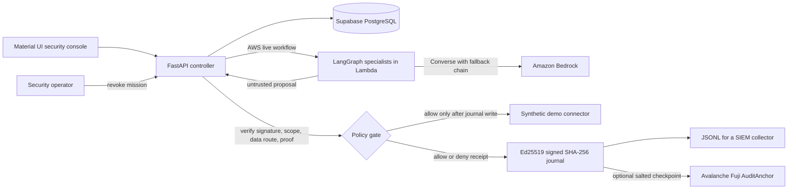

# AgentSafe

AgentSafe is a safety checkpoint between an AI agent and the tools it can use. The agent suggests an action. AgentSafe checks the mission's signed permissions and company rules, then records whether the action was allowed. In this demo, every business record and tool result is made up; the controller, cryptographic checks, database, and AWS model calls are real when their status says they are connected.

## Demo company

The console opens in **Acme Commerce**, a fictional online retailer. It has named `ag-*` agents, procurement missions, a confidential invoice, a supplier, group policies, alerts, and a signed audit journal. The same company workspace appears throughout the app. The demo connectors only record pretend outcomes: they never send an email, contact a supplier, or move money.

## Run a workflow

The AWS path runs three named specialists in LangGraph and calls Amazon Bedrock directly. Anthropic is first, followed by Mistral, Nova Lite, Claude Haiku, and Nova 2 Lite as model fallbacks. The model can suggest a destination, but it cannot approve the transfer. AgentSafe checks the signed delegation and blocks a confidential invoice from going to personal email. A shared database limit caps the live workflow at ten runs per UTC day.

The live AWS architecture is complete without AgentCore: Lambda is the deployed compute runtime, LangGraph coordinates the three specialists, and Bedrock Converse supplies the models. These are different layers, so LangGraph is the orchestration framework and Lambda is the runtime alternative in this deployment. The workshop role denies AgentCore runtime API access, and no OpenSearch collection was provisioned; policy notes are bundled with the demo. The local policy workflow is deterministic and makes no model call. Each card in the app states which systems it uses.

## Product screens

- **Overview:** company context, recent controller events, and policy health.
- **Run a workflow:** run the Bedrock-backed specialists or deterministic policy scenarios.
- **Agent permissions:** inspect mandates, scopes, budgets, expiry, delegation, and revocation.
- **Groups & missions:** inspect shared policies and synthetic team rosters.
- **Audit evidence:** verify signed events, export JSONL, and anchor a salted checkpoint to Avalanche Fuji.
- **Alerts & response:** investigate blocked actions and revoke future authority.

## Architecture



## Technology

| Part | Technology | What it does |
| --- | --- | --- |
| Controller and API | Python, FastAPI, Pydantic | Enforce the policy and record the decision |
| Hosted persistence | Supabase PostgreSQL session pooler | Store the demo company's missions and audit history |
| Agent workflow | LangGraph on AWS Lambda | Run named specialist steps and manage model fallback |
| Model calls | Amazon Bedrock Converse | Generate analysis and an untrusted action proposal |
| Model order | Claude Sonnet → Mistral Pixtral → Nova Lite → Claude Haiku → Nova 2 Lite | Try the preferred provider first and fall back if it fails |
| Dashboard | React, TypeScript, Material UI, Vite | Show company operations and let an analyst respond |
| Delegation privacy | Circom, Poseidon, Groth16, snarkjs | Prove selected parent/child mandate constraints |
| Signatures and journal | Ed25519, SHA-256 | Authenticate mandates and make journal edits detectable |
| Optional external checkpoint | Avalanche Fuji | Record a salted fingerprint of a journal head |

AgentCore and OpenSearch are not active in the workshop deployment, but neither is required for the deployed Lambda + LangGraph + Bedrock workflow. The prototype does not include real company connectors, SIEM delivery, authenticated enterprise approvers, or production ZK parameters.

**Live AWS demo:** [Open AgentSafe](https://7zjv7oxejxnxrq63rxahstxa2a0rbgee.lambda-url.us-west-2.on.aws/). It runs as an AWS Lambda container with a public HTTPS Function URL, shared Supabase PostgreSQL persistence, and a ten-request concurrency cap. The live Bedrock workflow has a separate limit of ten runs per UTC day.

**Verified on October 11, 2026:** the live browser button completed all three Bedrock-backed LangGraph steps. The planner proposed sending the confidential invoice to a personal email; the independent controller denied it and saved the signed receipt. The delegation proof verified as Groth16, and the current 33-event journal verifies with no errors. A prior journal checkpoint is confirmed on Avalanche Fuji: [view the transaction](https://build.avax.network/explorer/fuji/c-chain/tx/0xd78024ab65943451fc6ebb37c962e1cf3b581876a6c3d68ab5b7907a5861aa4e). These checks use synthetic company data and do not call an external business tool.

## Development

The hosted AWS demo is the primary live path. For isolated development, use Python 3.10+, Node.js 20+, npm, and `uv`:

```bash
cd controller
uv sync
npm ci
npm run build
uv run uvicorn app:app --host 127.0.0.1 --port 8765
```

The proof setup in `controller/zk/build` is a one-party development setup. It is useful for demonstrating the circuit but is not an audited production ceremony. If the database URL is not configured, local development uses SQLite.

## Security boundaries

- Agents propose actions; only the controller authorizes them.
- Protected tools must not keep a second credential path that lets an agent bypass the controller.
- A journal signature proves which controller key signed an event. It does not prove the model reasoned correctly or that an external tool response was true.
- A hash chain makes changes to recorded history detectable. A database administrator can still delete the newest events unless a checkpoint has been stored elsewhere.
- A Fuji checkpoint contains a salted commitment, not the journal contents. Wallet confirmation and test AVAX are required; the transaction value is zero.
- Synthetic demo data should not be mistaken for a customer's internal systems or records.

See [`HOW_AGENTSAFE_WORKS.md`](HOW_AGENTSAFE_WORKS.md) for the simple walkthrough and diagrams, [`PROJECT_GUIDE.md`](PROJECT_GUIDE.md) for the request path, and [`PRODUCT_SPEC.md`](PRODUCT_SPEC.md) for guarantees and limitations.
